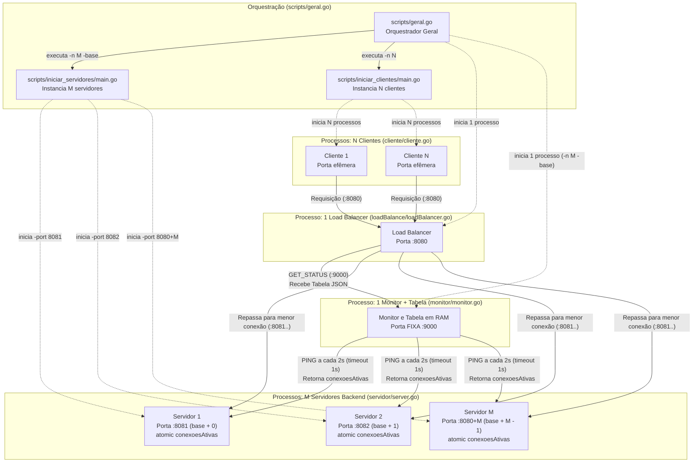
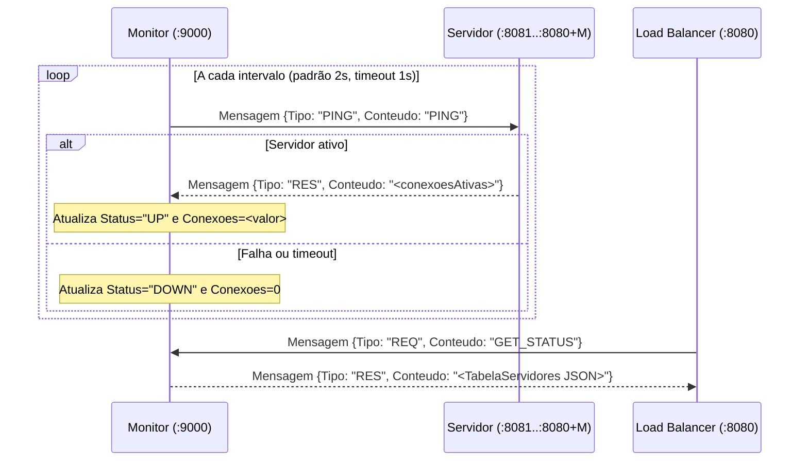

# Decisões de Arquitetura e Implementação

Este documento registra todas as decisões técnicas tomadas até o momento no projeto **Balanceador de Carga TCP (Least Connections)**, bem como o mapeamento de processos e portas.

---

## 1. Diagrama de Servidores, Processos e Portas



---

## 2. Mapeamento de Portas

| Componente | Arquivo | Porta | Quantidade de Processos | Observações |
| :--- | :--- | :--- | :--- | :--- |
| **Clientes** | [`cliente/cliente.go`](file:///home/vhwcm/Trabalho-redes-2/cliente/cliente.go) | Efêmera (SO) | `N` | Envia requisições para `localhost:8080`. |
| **Load Balancer** | [`loadBalance/loadBalancer.go`](file:///home/vhwcm/Trabalho-redes-2/loadBalance/loadBalancer.go) | `:8080` | `1` | Ponto de entrada único dos clientes *(implementação pendente)*. |
| **Monitor / Tabela** | [`monitor/monitor.go`](file:///home/vhwcm/Trabalho-redes-2/monitor/monitor.go) | `:9000` **(fixa)** | `1` | Não configurável por flag; gerencia estado e responde consultas na `:9000`. |
| **Servidores Backend** | [`servidor/server.go`](file:///home/vhwcm/Trabalho-redes-2/servidor/server.go) | `:8081` a `:8080 + M` (configurável via `-base`) | `M` | Cada servidor é 1 processo independente ouvindo em 1 porta (`-port`). |

---

## 3. Decisões Tomadas

### 3.1. Isolamento dos scripts `main` em `scripts/`
- **Problema:** Ter `func main()` em mais de um arquivo dentro da mesma pasta `scripts/` (`iniciar_servidores.go` e `iniciar_clientes.go`) violava a regra de pacote único por diretório em Go (`main redeclared in this block`).
- **Decisão:** Mover os inicializadores individuais para subpacotes próprios:
  - [`scripts/iniciar_servidores/main.go`](file:///home/vhwcm/Trabalho-redes-2/scripts/iniciar_servidores/main.go)
  - [`scripts/iniciar_clientes/main.go`](file:///home/vhwcm/Trabalho-redes-2/scripts/iniciar_clientes/main.go)
  - [`scripts/geral.go`](file:///home/vhwcm/Trabalho-redes-2/scripts/geral.go) permanece como o único `main` na raiz de `scripts/`.

### 3.2. Unificação do Monitor e da Tabela de Servidores na porta fixa `9000`
- **Decisão:** Remover o processo separado `tabela/tabela.go` e unificar toda a tabela em memória (`TabelaServidores`, `ServidorStatus` e `sync.Mutex`) dentro de [`monitor/monitor.go`](file:///home/vhwcm/Trabalho-redes-2/monitor/monitor.go).
- **Porta fixa:** Removida a flag de porta do monitor; a porta é fixa pela constante `portaMonitor = 9000`.
- **Interface TCP na `:9000`:** Ao receber `GET_STATUS` (ou comando vazio/desconhecido), o monitor devolve a tabela serializada em JSON no campo `Conteudo` de uma `rede.Mensagem`. Também mantém suporte a `INC_CONEXAO` e `DEC_CONEXAO`.

### 3.3. Um processo por servidor com threads (goroutines) dinâmicas
- **Decisão:** Removido `totalServidores` (`-n` / `-base`) de [`servidor/server.go`](file:///home/vhwcm/Trabalho-redes-2/servidor/server.go).
- **Funcionamento:** Cada execução de `server.go` representa **exatamente 1 processo de servidor** ouvindo em uma porta (`-port`, padrão `8081`). A cada conexão aceita no loop `Accept()`, uma nova goroutine é alocada dinamicamente em `atenderConexao`, com encerramento gracioso via `SIGINT`/`SIGTERM` e `sync.WaitGroup`.
- **Spawn múltiplo:** Quem sobe `M` processos de servidor é [`scripts/iniciar_servidores/main.go`](file:///home/vhwcm/Trabalho-redes-2/scripts/iniciar_servidores/main.go), passando `-port <base + i>` para cada instância.

### 3.4. Orquestração delegada em `scripts/geral.go`
- **Decisão:** [`scripts/geral.go`](file:///home/vhwcm/Trabalho-redes-2/scripts/geral.go) instancia `N` clientes, `M` servidores, `1` monitor e `1` load balancer, **delegando** a criação de servidores e clientes aos scripts [`scripts/iniciar_servidores/main.go`](file:///home/vhwcm/Trabalho-redes-2/scripts/iniciar_servidores/main.go) e [`scripts/iniciar_clientes/main.go`](file:///home/vhwcm/Trabalho-redes-2/scripts/iniciar_clientes/main.go).
- Os binários são compilados em arquivos temporários para que sinais `SIGTERM` enviados pelo `geral.go` cheguem diretamente aos processos filhos e realizem limpeza completa sem deixar processos órfãos.

### 3.5. Monitoramento de Status e Conexões Ativas via `PING` (Opção A)
- **Decisão:** Cada servidor mantém internamente seu próprio contador de conexões ativas (`conexoesAtivas` via `atomic.Int64` em [`servidor/server.go`](file:///home/vhwcm/Trabalho-redes-2/servidor/server.go)).
- **Protocolo:** Adicionado `TipoPing = "PING"` em [`rede/protocolo.go`](file:///home/vhwcm/Trabalho-redes-2/rede/protocolo.go) e `ConectarTCPTimeout` em [`rede/socket.go`](file:///home/vhwcm/Trabalho-redes-2/rede/socket.go).
  - Ao receber `Tipo == "PING"` (ou `Conteudo == "PING"`), o servidor responde com a quantidade atual de conexões ativas **sem contabilizar o próprio `PING` como conexão de cliente**.
  - Requisições normais incrementam `conexoesAtivas` ao iniciar o atendimento e decrementam com `defer` ao encerrar.
- **Periodicidade e Descoberta:**
  - O monitor checa todos os servidores em paralelo a cada **`-intervalo`** segundos (padrão **2 segundos**, timeout de conexão/leitura de **1 segundo**).
  - A quantidade de servidores monitorados é definida na inicialização pelas flags `-n` (padrão `3`) e `-base` (padrão `8081`), cobrindo as portas `base` até `base + n - 1` (repassadas automaticamente pelo `geral.go`).
  - Se o servidor responder ao `PING` com um inteiro válido, fica marcado como `UP` com o número retornado de conexões; se falhar ou der timeout, fica `DOWN` com `0` conexões.



### 3.6. Auto-recuperação de servidores caídos a cada 5 segundos
- **Decisão:** O próprio [`monitor/monitor.go`](file:///home/vhwcm/Trabalho-redes-2/monitor/monitor.go) é responsável por detectar e subir novamente servidores que caírem.
- **Funcionamento:**
  - Ao iniciar, o monitor compila `./servidor` uma única vez em um binário temporário (`compilarServidor`).
  - A goroutine `iniciarRecuperacao` roda em paralelo com um `time.Ticker` fixo de **5 segundos** (`intervaloRecuperacao = 5 * time.Second`).
  - A cada 5 segundos, para cada servidor registrado como `DOWN`, o monitor confirma com um `PING` imediato (`!checarServidor(porta)`) e, se continuar fora do ar, inicia um novo processo do servidor naquela porta (`-port <porta>`), atualizando a tabela logo em seguida.
  - Ao encerrar (`SIGINT`/`SIGTERM`), o monitor também encerra os processos de servidor que ele mesmo recuperou e remove o binário temporário.

---

## 4. Comandos Principais

```bash
# Subir o ambiente completo (N clientes, M servidores, 1 monitor e 1 load balancer)
go run ./scripts/geral.go -n 3 -m 3

# Subir apenas M servidores
go run ./scripts/iniciar_servidores -n 3 -base 8081

# Subir apenas N clientes
go run ./scripts/iniciar_clientes -n 3

# Subir apenas 1 servidor manualmente
go run ./servidor -port 8081

# Subir apenas o monitor (sempre na porta fixa 9000)
go run ./monitor -n 3 -base 8081 -intervalo 2
```

---

## 5. Pendências Conhecidas
- Implementar a lógica do [`loadBalance/loadBalancer.go`](file:///home/vhwcm/Trabalho-redes-2/loadBalance/loadBalancer.go) (corrigir a porta para `":8080"`, consultar a tabela no monitor `:9000`, selecionar o servidor `UP` com menor `conexoes` e repassar a requisição).
- Avaliar se [`cliente/cliente.go`](file:///home/vhwcm/Trabalho-redes-2/cliente/cliente.go) continuará usando `http.Get` ou migrará para socket TCP puro com [`rede/socket.go`](file:///home/vhwcm/Trabalho-redes-2/rede/socket.go) conforme especificado no [`README.md`](file:///home/vhwcm/Trabalho-redes-2/README.md).
