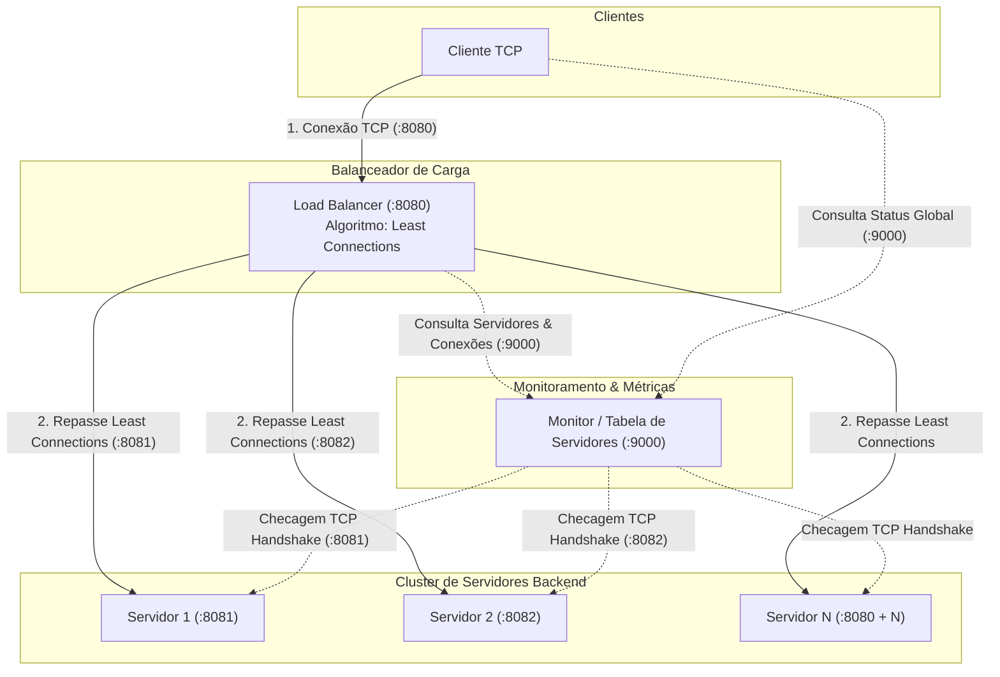

# Trabalho de Redes II

---

Balanceamento: Least Connections

---

## portas       

| Componente | Porta Padrão | Protocolo de Transporte | Formato do Payload | Descrição / Papel no Sistema |
| :--- | :--- | :--- | :--- | :--- |
| **Load Balancer** | `:8080` | TCP (`net.Listen`) | JSON (`Mensagem`) | Ponto único de entrada dos clientes. Aplica **Least Connections** para escolher o backend ativo. |
| **Servidores Backend** | `:8081` a `:8080 + N` | TCP (`net.Listen`) | JSON (`Mensagem`) | Processam as requisições dos clientes. |
| **Monitor (Métricas)** | `:9000` | TCP (`net.Listen`) | JSON (`Mensagem`) | Mantém a `TabelaServidores`, checa se as portas TCP estão abertas (UP/DOWN) e expõe o status atualizado do cluster. |
| **Clientes** | Portas Efêmeras do SO | TCP (`net.Dial`) | JSON (`Mensagem`) | Conectam-se ao Load Balancer (`:8080`) para solicitar tarefas ou ao Monitor (`:9000`) para ver métricas. |

---