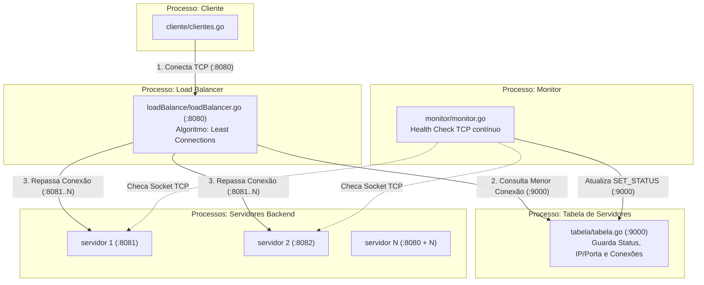

# Trabalho de Redes II - Balanceador de Carga TCP (Least Connections)

Arquitetura distribuída com processos completamente desacoplados utilizando exclusivamente sockets TCP em Go (`net`) com serialização em JSON delimitada por `\n`.

---

## 🗺️ Arquitetura e Diagrama de Conexões



---

## 🧩 Os 5 Processos do Sistema

| Processo / Binário | Porta | Função |
| :--- | :--- | :--- |
| **`servidor/server.go`** | `:8081` a `:8080+N` | Executa os servidores backend de trabalho. |
| **`tabela/tabela.go`** | `:9000` | Processo de estado. Mantém a tabela em RAM com IP, porta, status (UP/DOWN) e conexões de cada servidor. |
| **`monitor/monitor.go`** | - | Processo de health check. Testa se as portas dos servidores estão abertas e avisa a Tabela (`SET_STATUS`). |
| **`loadBalance/loadBalancer.go`** | `:8080` | Balanceador de carga. Consulta a Tabela para escolher o servidor com **Least Connections** e repassa o cliente. |
| **`cliente/clientes.go`** | Efêmera | Envia requisições para a porta `:8080` do Load Balancer. |

---

## 🚀 Como Executar o Sistema

Abra terminais separados para rodar cada processo:

### 1. Iniciar a Tabela de Servidores (Processo de Estado)
```bash
go run ./tabela -n=3 -base=8081 -port=9000
```

### 2. Iniciar os Servidores Backend
```bash
go run ./servidor 3
```

### 3. Iniciar o Monitor (Health Check)
```bash
go run ./monitor -n=3 -base=8081 -tabela-port=9000
```
*(O monitor começará a checar os servidores e atualizar a tabela com `UP` ou `DOWN`).*

### 4. Consultar a Tabela em Tempo Real (Via TCP)
```bash
python3 -c "import socket; s = socket.socket(); s.connect(('localhost', 9000)); s.send(b'{\"tipo\":\"REQ\",\"conteudo\":\"GET_STATUS\"}\n'); print(s.recv(2048).decode()); s.close()"
```
