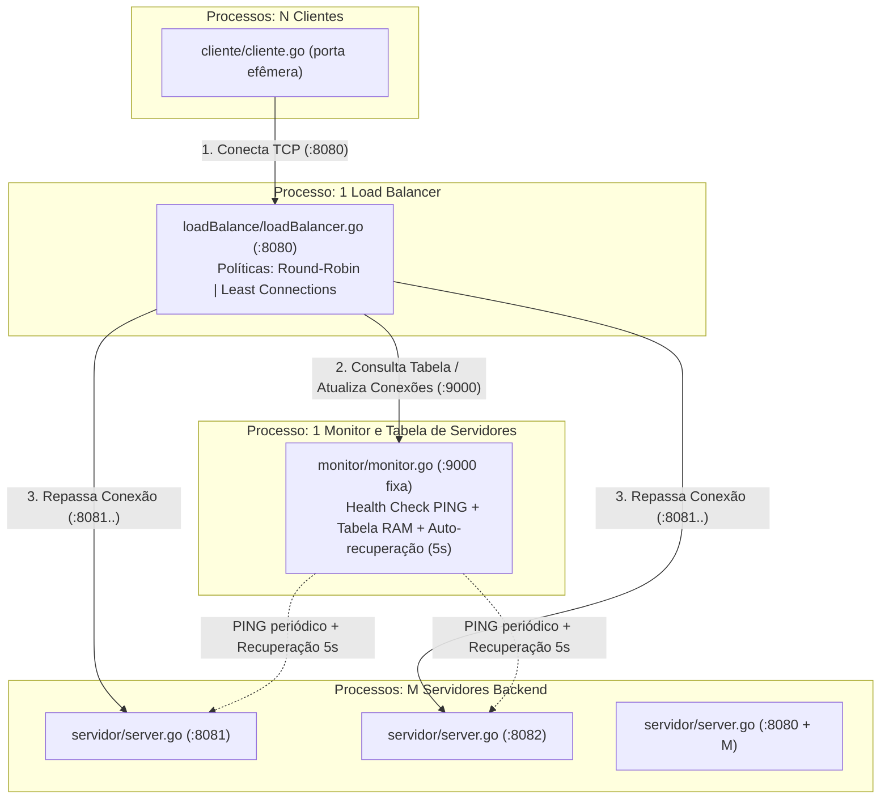

# Trabalho de Redes II - Balanceador de Carga TCP

Arquitetura distribuída com processos desacoplados utilizando exclusivamente sockets TCP em Go (`net`) com serialização em JSON delimitada por `\n` (pacote [`rede`](file:///home/vhwcm/Trabalho-redes-2/rede/socket.go)).

Para o histórico completo de decisões de projeto, veja [`DECISOES.md`](file:///home/vhwcm/Trabalho-redes-2/DECISOES.md).

---

## Arquitetura e Diagrama de Conexões



---

## Processos do Sistema

| Processo / Binário | Porta | Função |
| :--- | :--- | :--- |
| **`servidor/server.go`** | `:8081` a `:8080+M` | Executa 1 servidor backend por processo (`-port`), mantendo contador atômico de conexões ativas e respondendo a `PING` e requisições de clientes. |
| **`monitor/monitor.go`** | `:9000` (fixa) | Processo unificado de health check (`PING`), tabela de servidores em RAM (`IP`, `Porta`, `Status`, `Conexoes`, `TotalConexoes`) e auto-recuperação de servidores caídos a cada `5s`. |
| **`loadBalance/loadBalancer.go`** | `:8080` | Balanceador de carga TCP concorrente com políticas **Round-Robin** (`-politica round-robin`) e **Least Connections** (`-politica least-connections`). |
| **`cliente/cliente.go`** | Efêmera | Conecta apenas no Load Balancer (`:8080`) e envia dados por `K` segundos fixos (`-k`) ou variáveis (`-k-min` e `-k-max`). |

---

## Execução e Logs

```bash
# Subir ambiente completo com política Least Connections e clientes com duração variável (2s a 6s)
go run ./scripts/geral.go -n 4 -m 3 -politica least-connections -k-min 2 -k-max 6

# Subir ambiente completo com política Round-Robin e duração fixa (5s)
go run ./scripts/geral.go -n 4 -m 3 -politica round-robin -k 5
```

Todos os processos registram os eventos de execução simultaneamente no terminal e no arquivo [`log.txt`](file:///home/vhwcm/Trabalho-redes-2/log.txt).