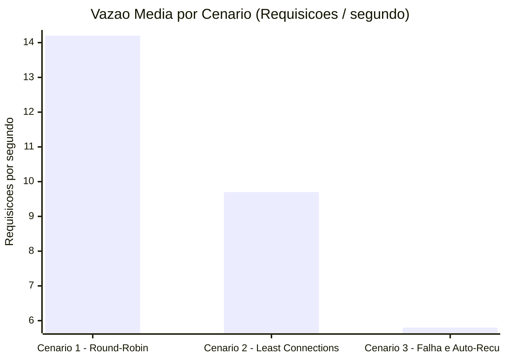
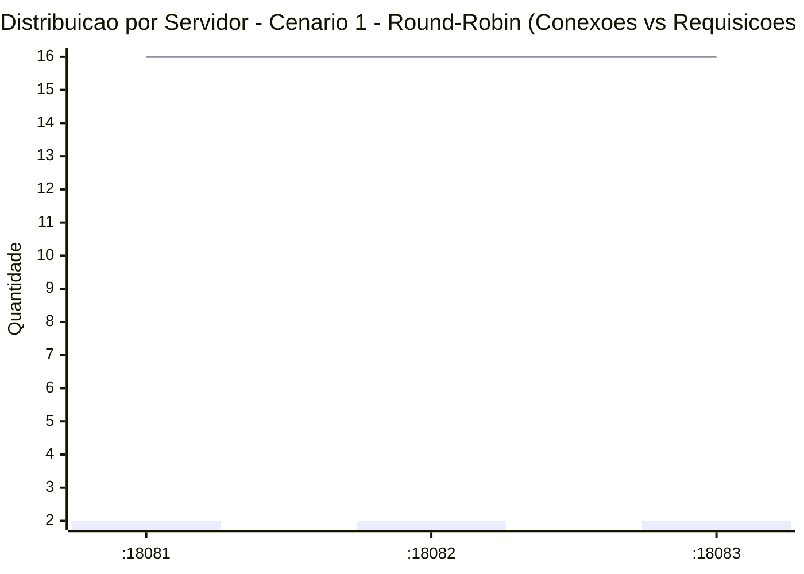
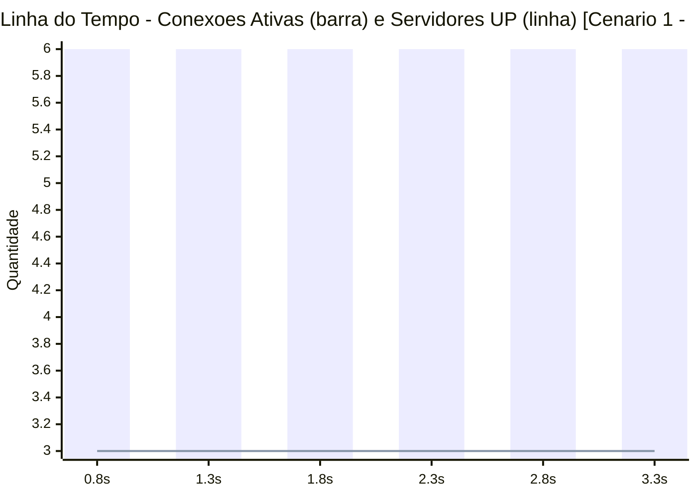
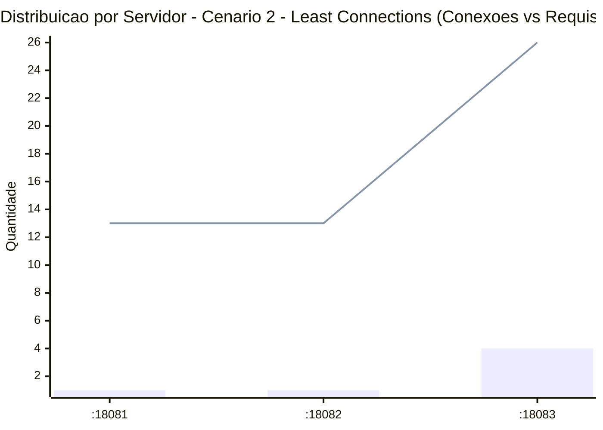
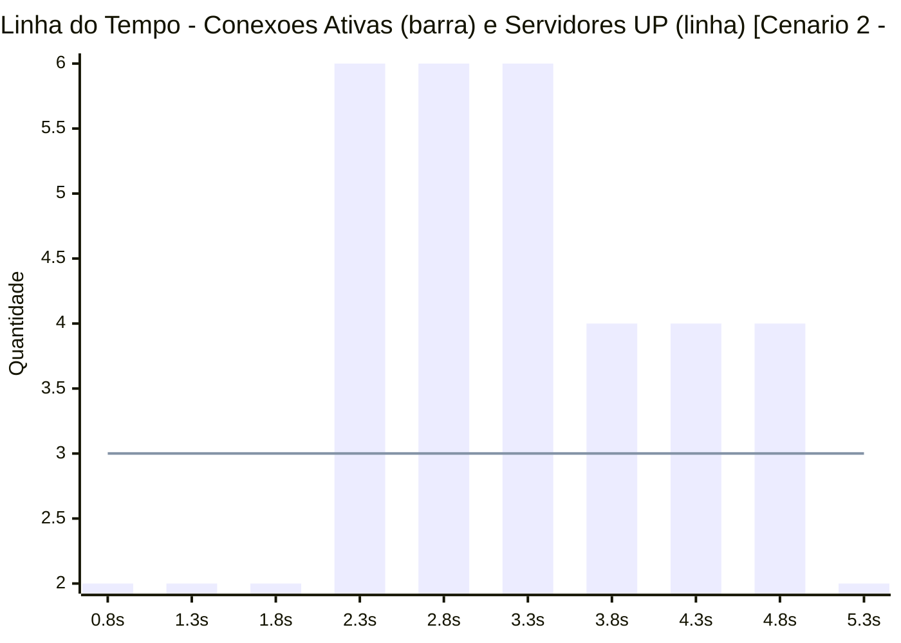
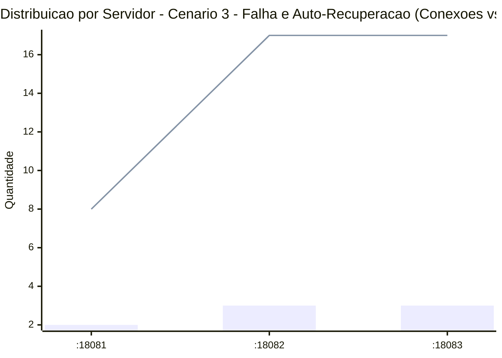
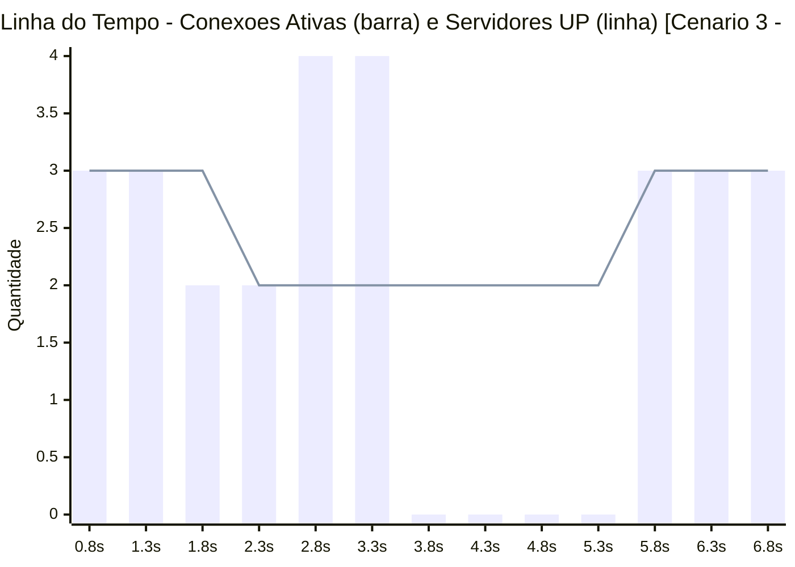

# Relatório Completo de Execução, Desempenho e Tolerância a Falhas

- **Data/Hora da Execução:** `2026-11-15 17:51:26`
- **Tempo Total da Suíte de Testes:** `16.74s`
- **Arquivo de Log Analisado:** [`log.txt`](file:///home/vhwcm/Trabalho-redes-2/log.txt)

---

## 1. Parâmetros Globais e Tempos de Inicialização / Compilação

| Componente / Pacote | Porta | Tempo de Compilação (ms) | Papel na Arquitetura |
| :--- | :--- | :---: | :--- |
| `./scripts/iniciar_servidores` | `-` | `235.6 ms` | Spawner de `M` processos de servidor |
| `./scripts/iniciar_clientes` | Efêmera | `127.5 ms` | Spawner de `N` processos de cliente |
| `./monitor` | `:9000` (fixa) | `198.5 ms` | Health Check (`PING`), Tabela em RAM e Auto-recuperação (5s) |
| `./loadBalance` | `:8080` | `174.4 ms` | Balanceador TCP concorrente (`Round-Robin` / `Least Connections`) |

### Resumo Comparativo dos Cenários

| Cenário | Política | Clientes | Servidores | Tempo de Boot Infra | Duração Total | Conexões (LB) | Requisições Atendidas | Vazão (req/s) | Vazão (conn/s) | Quedas / Recuperações |
| :--- | :---: | :---: | :---: | :---: | :---: | :---: | :---: | :---: | :---: | :---: |
| **Cenario 1 - Round-Robin** | `round-robin` | `6` (fixa 3s) | `3` (`:18081..:18083`) | `306.5 ms` | `3.37s` | `6` | `48` | `14.23 req/s` | `1.78 conn/s` | `0` / `0` |
| **Cenario 2 - Least Connections** | `least-connections` | `6` (ondas 5s + 2..3s) | `3` (`:18081..:18083`) | `303.5 ms` | `5.36s` | `6` | `52` | `9.70 req/s` | `1.12 conn/s` | `0` / `0` |
| **Cenario 3 - Falha e Auto-Recuperacao** | `least-connections` | `8` (3 ondas (pré-queda, durante queda, pós-recuperação)) | `3` (`:18081..:18083`) | `303.4 ms` | `7.26s` | `8` | `42` | `5.79 req/s` | `1.10 conn/s` | `1` / `1` |

---

## 2. Detalhamento — Cenario 1 - Round-Robin

> Valida a distribuição circular uniforme de 6 clientes simultâneos entre 3 servidores backend usando a política Round-Robin.

### Parâmetros e Métricas de Velocidade

- **Política de Balanceamento:** `round-robin`
- **Servidores Monitorados:** `3` (portas `:18081` a `:18083`, intervalo do monitor `1s`)
- **Clientes Simulados:** `6` (`fixa 3s`)
- **Tempo de Inicialização (Boot até todos os servidores `UP`):** `306.5 ms`
- **Duração Total do Cenário:** `3.37 s`
- **Velocidade / Vazão Média:** `14.23 req/s` (`48` requisições totais) | `1.78 conexões/s` (`6` conexões totais)

### Distribuição de Carga por Servidor

| Servidor (Porta) | Conexões Recebidas (LB) | % das Conexões | Requisições Atendidas | % das Requisições |
| :--- | :---: | :---: | :---: | :---: |
| `127.0.0.1:18081` | `2` | `33.3%` | `16` | `33.3%` |
| `127.0.0.1:18082` | `2` | `33.3%` | `16` | `33.3%` |
| `127.0.0.1:18083` | `2` | `33.3%` | `16` | `33.3%` |

### Evolução Temporal de Conexões Ativas e Status dos Servidores

### Linha do Tempo de Eventos Extraídos do `log.txt`

| Tempo Relativo (s) | Componente | Evento |
| :---: | :---: | :--- |
| `+0.000s` | `CENARIO` | Iniciando Cenario 1 - Round-Robin (round-robin) |
| `+0.255s` | `Servidor :18081` | Servidor online e ouvindo |
| `+0.255s` | `Servidor :18083` | Servidor online e ouvindo |
| `+0.255s` | `Servidor :18082` | Servidor online e ouvindo |
| `+0.268s` | `MONITOR` | Porta :18083 mudou DOWN -> UP |
| `+0.268s` | `MONITOR` | Porta :18081 mudou DOWN -> UP |
| `+0.268s` | `MONITOR` | Porta :18082 mudou DOWN -> UP |
| `+0.559s` | `LB` | Conexão direcionada -> :18083 (conexões prévias=0) |
| `+0.559s` | `LB` | Conexão direcionada -> :18081 (conexões prévias=0) |
| `+0.559s` | `LB` | Conexão direcionada -> :18082 (conexões prévias=0) |
| `+0.560s` | `LB` | Conexão direcionada -> :18081 (conexões prévias=0) |
| `+0.561s` | `LB` | Conexão direcionada -> :18082 (conexões prévias=0) |
| `+0.561s` | `LB` | Conexão direcionada -> :18083 (conexões prévias=1) |
| `+3.372s` | `CENARIO` | Finalizando Cenario 1 - Round-Robin (duração=3.37s) |

---

## 3. Detalhamento — Cenario 2 - Least Connections

> Valida a política Least Connections com clientes de durações variáveis (2s a 5s) chegando em duas ondas, direcionando novas conexões para os servidores menos ocupados.

### Parâmetros e Métricas de Velocidade

- **Política de Balanceamento:** `least-connections`
- **Servidores Monitorados:** `3` (portas `:18081` a `:18083`, intervalo do monitor `1s`)
- **Clientes Simulados:** `6` (`ondas 5s + 2..3s`)
- **Tempo de Inicialização (Boot até todos os servidores `UP`):** `303.5 ms`
- **Duração Total do Cenário:** `5.36 s`
- **Velocidade / Vazão Média:** `9.70 req/s` (`52` requisições totais) | `1.12 conexões/s` (`6` conexões totais)

### Distribuição de Carga por Servidor

| Servidor (Porta) | Conexões Recebidas (LB) | % das Conexões | Requisições Atendidas | % das Requisições |
| :--- | :---: | :---: | :---: | :---: |
| `127.0.0.1:18081` | `1` | `16.7%` | `13` | `25.0%` |
| `127.0.0.1:18082` | `1` | `16.7%` | `13` | `25.0%` |
| `127.0.0.1:18083` | `4` | `66.7%` | `26` | `50.0%` |

### Evolução Temporal de Conexões Ativas e Status dos Servidores

### Linha do Tempo de Eventos Extraídos do `log.txt`

| Tempo Relativo (s) | Componente | Evento |
| :---: | :---: | :--- |
| `+0.000s` | `CENARIO` | Iniciando Cenario 2 - Least Connections (least-connections) |
| `+0.207s` | `Servidor :18083` | Servidor online e ouvindo |
| `+0.207s` | `Servidor :18082` | Servidor online e ouvindo |
| `+0.207s` | `Servidor :18081` | Servidor online e ouvindo |
| `+0.213s` | `MONITOR` | Porta :18083 mudou DOWN -> UP |
| `+0.213s` | `MONITOR` | Porta :18082 mudou DOWN -> UP |
| `+0.213s` | `MONITOR` | Porta :18081 mudou DOWN -> UP |
| `+0.303s` | `CENARIO` | Disparando Onda 1: 2 clientes longos (5s) |
| `+0.546s` | `LB` | Conexão direcionada -> :18082 (conexões prévias=0) |
| `+0.546s` | `LB` | Conexão direcionada -> :18081 (conexões prévias=0) |
| `+1.804s` | `CENARIO` | Disparando Onda 2: 4 clientes de duração variável (2s a 3s) |
| `+1.998s` | `LB` | Conexão direcionada -> :18083 (conexões prévias=0) |
| `+1.998s` | `LB` | Conexão direcionada -> :18083 (conexões prévias=0) |
| `+1.998s` | `LB` | Conexão direcionada -> :18083 (conexões prévias=0) |
| `+1.998s` | `LB` | Conexão direcionada -> :18083 (conexões prévias=0) |
| `+5.359s` | `CENARIO` | Finalizando Cenario 2 - Least Connections (duração=5.36s) |

---

## 4. Detalhamento — Cenario 3 - Falha e Auto-Recuperacao

> Simula a queda abrupta (SIGKILL) do servidor primário durante a execução, verificando a detecção de falha pelo Monitor (PING), o redirecionamento de novos clientes para servidores ativos e a auto-recuperação em 5 segundos.

### Parâmetros e Métricas de Velocidade

- **Política de Balanceamento:** `least-connections`
- **Servidores Monitorados:** `3` (portas `:18081` a `:18083`, intervalo do monitor `1s`)
- **Clientes Simulados:** `8` (`3 ondas (pré-queda, durante queda, pós-recuperação)`)
- **Tempo de Inicialização (Boot até todos os servidores `UP`):** `303.4 ms`
- **Duração Total do Cenário:** `7.26 s`
- **Velocidade / Vazão Média:** `5.79 req/s` (`42` requisições totais) | `1.10 conexões/s` (`8` conexões totais)
- **Tolerância a Falhas:** `1` queda(s) detectada(s) | `1` auto-recuperação(ões) executada(s) | Tempo entre detecção `DOWN` e retorno `UP`: `3.20 s`

### Distribuição de Carga por Servidor

| Servidor (Porta) | Conexões Recebidas (LB) | % das Conexões | Requisições Atendidas | % das Requisições |
| :--- | :---: | :---: | :---: | :---: |
| `127.0.0.1:18081` | `2` | `25.0%` | `8` | `19.0%` |
| `127.0.0.1:18082` | `3` | `37.5%` | `17` | `40.5%` |
| `127.0.0.1:18083` | `3` | `37.5%` | `17` | `40.5%` |

### Evolução Temporal de Conexões Ativas e Status dos Servidores

### Linha do Tempo de Eventos Extraídos do `log.txt`

| Tempo Relativo (s) | Componente | Evento |
| :---: | :---: | :--- |
| `+0.000s` | `CENARIO` | Iniciando Cenario 3 - Falha e Auto-Recuperacao (least-connections) |
| `+0.205s` | `Servidor :18081` | Servidor online e ouvindo |
| `+0.205s` | `Servidor :18083` | Servidor online e ouvindo |
| `+0.205s` | `Servidor :18082` | Servidor online e ouvindo |
| `+0.212s` | `MONITOR` | Porta :18083 mudou DOWN -> UP |
| `+0.212s` | `MONITOR` | Porta :18081 mudou DOWN -> UP |
| `+0.212s` | `MONITOR` | Porta :18082 mudou DOWN -> UP |
| `+0.303s` | `CENARIO` | Disparando Onda 1: 3 clientes iniciais (3s) |
| `+0.537s` | `LB` | Conexão direcionada -> :18083 (conexões prévias=0) |
| `+0.537s` | `LB` | Conexão direcionada -> :18081 (conexões prévias=0) |
| `+0.537s` | `LB` | Conexão direcionada -> :18082 (conexões prévias=0) |
| `+1.504s` | `CENARIO` | FALHA INJETADA: derrubando servidor na porta :18081 (SIGKILL) |
| `+2.213s` | `MONITOR` | Porta :18081 mudou UP -> DOWN |
| `+2.306s` | `CENARIO` | Disparando Onda 2 (durante falha de :18081, detectada em 0.80s): 2 clientes (1s) |
| `+2.527s` | `LB` | Conexão direcionada -> :18083 (conexões prévias=1) |
| `+2.527s` | `LB` | Conexão direcionada -> :18082 (conexões prévias=1) |
| `+5.213s` | `MONITOR` | Auto-recuperação disparada para porta :18081 |
| `+5.215s` | `Servidor :18081` | Servidor online e ouvindo |
| `+5.414s` | `MONITOR` | Porta :18081 mudou DOWN -> UP |
| `+5.456s` | `CENARIO` | Disparando Onda 3 (após auto-recuperação de :18081): 3 clientes (2s) |
| `+5.649s` | `LB` | Conexão direcionada -> :18083 (conexões prévias=0) |
| `+5.649s` | `LB` | Conexão direcionada -> :18081 (conexões prévias=0) |
| `+5.649s` | `LB` | Conexão direcionada -> :18082 (conexões prévias=0) |
| `+7.257s` | `CENARIO` | Finalizando Cenario 3 - Falha e Auto-Recuperacao (duração=7.26s) |

---

